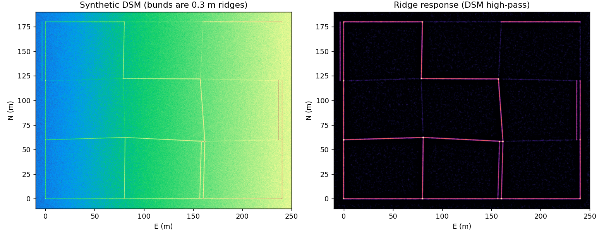
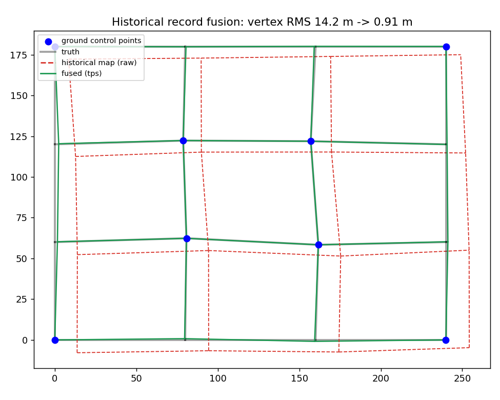
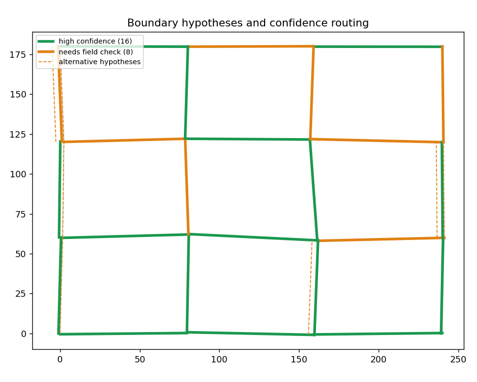
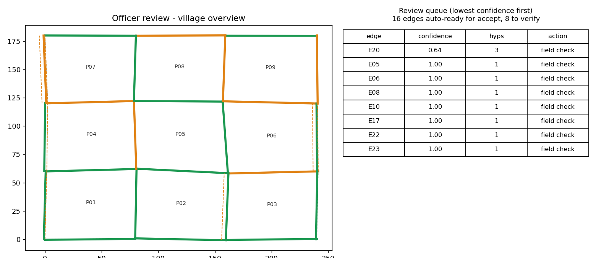

# NAKSHATRA

### Low-Cost PPK Drone-Based Survey and Resurvey System for Rural Agricultural Land

**Smart India Hackathon 2026** · Problem Statement ID: 26010 · Theme: Smart Automation · Category: Hardware
**Team:** EdgeX Hyperions · **Team ID:** 121045

---

## Overview

**NAKSHATRA** is a low-cost, drone-based surveying and resurveying system designed to improve the accuracy, traceability, and repeatability of rural agricultural land mapping.

It integrates **dual-band GNSS, PPK positioning, drone photogrammetry, GIS processing, boundary intelligence, historical record fusion, and officer-in-the-loop verification** into one workflow. Rather than replacing existing land-survey procedures, it is a **decision-support system** that gives survey and revenue authorities spatial evidence and confidence information for more efficient field verification.

### Core Objectives

- Generate accurate, georeferenced village-scale survey data.
- Reduce the cost of high-precision drone surveying.
- Digitally align historical village maps with current ground conditions.
- Identify and rank potential parcel boundaries.
- Prioritize field verification based on confidence and risk.
- Maintain a traceable and tamper-evident survey baseline.
- Support repeatable resurvey and GIS-based record management.
- Operate with an offline-first field workflow.


## Quick start (synthetic demo, no hardware needed)

```bash
pip install -r requirements.txt
python demo/run_demo.py          # fusion -> boundary scoring -> sealing -> figures
python -m pytest -q tests        # unit tests
```

Then open `web-console/index.html` (officer console) or `field-app/index.html` (offline surveyor app) in a browser.
Both read data generated by the demo.

### What the demo produces (synthetic village, not field data)

| | |
|---|---|
|  |  |
|  |  |

On the synthetic village: a historical map with ~14 m RMS vertex error is fused down to ~0.9 m using 8 ground control
points, and 16 of 24 boundary edges are routed as high confidence with 8 sent for field checks (every top hypothesis was
within 0.5 m of truth). These numbers come from simulated data with deliberately faint and decoy bunds; they show the
pipeline works, **not** how accurate it will be on real villages. See [`docs/methodology.md`](docs/methodology.md#5-validation-plan-not-yet-done).

## Implementation status

| Component | Status |
|---|---|
| Record fusion (Helmert / affine / TPS + LOOCV) | implemented, unit-tested on synthetic data |
| Boundary hypothesis scoring + confidence routing | implemented, unit-tested on synthetic data; weights not yet calibrated |
| Sealed baseline (hash, version chain, verify, compare) | implemented, unit-tested |
| Parcel areas + GeoJSON export | implemented |
| Event alignment + geotag generation | implemented, unit-tested on synthetic events |
| PPK driver (RTKLIB), ODM runner | written, dry-run only; not yet run on real data |
| STM32 firmware (drone + base) | reference code, not yet compiled or run on hardware |
| Officer console, surveyor app | working demos on synthetic data |
| Field accuracy (PPK, orthomosaic, boundaries) | **not yet measured** |

## Problem Statement

Rural land records often drift from physical ground conditions:

- Historical village maps may lack reliable ground coordinates.
- Chain and ETS surveys need significant time and field resources.
- Boundary stones and bunds shift, disappear, or become hard to identify.
- 7/12 records, mutation records, registration records, and spatial maps live in separate systems.
- Commercial high-precision PPK solutions are expensive at scale.
- Rural connectivity is unreliable.
- Uncertain or disputed boundaries prolong verification.

## Proposed Solution

```text
Village AOI + Existing Records
              │
              ▼
       Drone Data Capture
              │
              ▼
      GNSS / Base Logging
              │
              ▼
       PPK + Datum Solution
              │
              ▼
        Photogrammetry
              │
       ┌──────┼──────┐
       ▼      ▼      ▼
     Ortho   DSM    DTM
       └──────┼──────┘
              ▼
      Feature Extraction
              │
              ▼
      Historical Map Fusion
              │
              ▼
    Boundary Hypothesis Engine
              │
              ▼
      Confidence Assessment
          │           │
       High          Low
          │           │
          ▼           ▼
      Candidate    Field Check
       Boundary        │
          │            ▼
          │       Surveyor App
          └──────┬─────┘
                 ▼
          Officer Review
                 ▼
          Sealed Baseline
                 ▼
        GIS / ULPIN Export
```


## System Architecture

### 01 — Field Capture Layer

- F450-class airframe, mapping camera, dual-band GNSS, IMU, optional LiDAR
- STM32-based time-synchronization logger recording raw GNSS observations, PPS timing, camera shutter events, and survey metadata
- Dedicated GNSS base station on a village control pillar

### 02 — Intelligence Layer

```text
Drone Raw GNSS + Base Raw GNSS + Nearest CORS Reference
                      │
                      ▼
                   RTKLIB
                      │
                      ▼
        PPK-Corrected Drone Trajectory
```

OpenDroneMap produces the orthomosaic, DSM and DTM. Boundary evidence is extracted from agricultural bunds, hedges, roads, DSM ridge lines, and historical maps. Multiple boundary hypotheses are retained instead of forcing a premature single choice.

### 03 — Verification Layer

Each candidate boundary gets a confidence assessment. High-confidence boundaries go to officer review; low-confidence ones go to field verification via the surveyor app, then back into updated analysis. Survey effort is concentrated on uncertain or disputed areas.

## Historical Record Fusion

```text
Historical Village Map → Helmert → Affine → TPS → Fused Spatial Layer
```

Residuals and significant mismatches are retained for review, giving a measurable indication of how well historical records match the current survey.

## Sealed Survey Baseline

A completed survey becomes a fixed baseline containing the orthomosaic, raw GNSS observations, parcel layer, metadata, timestamp, cryptographic hash, and version information. Future resurveys are compared against it.

## Offline-First Architecture

- **Field:** drone/GNSS → local storage → offline survey
- **Office:** PPK processing → photogrammetry → GIS + boundary analysis → verification

## Technology Stack

| Layer | Technology |
|---|---|
| Flight Platform | F450-class UAV |
| Positioning | Dual-band GNSS |
| PPK | RTKLIB |
| Photogrammetry | OpenDroneMap |
| GIS | QGIS |
| Embedded Logger | STM32 |
| Data Processing | Python |
| Boundary Analysis | GIS / Python |
| Field Interface | Offline-first mobile application |
| Web Interface | Web-based verification console |

## End-to-End Workflow

1. **Define survey area** – load village AOI and historical records
2. **Establish base** – deploy GNSS base at the village control point
3. **Conduct drone survey** – overlapping imagery synced with GNSS
4. **Perform PPK** – RTKLIB with raw drone, base, and nearest CORS data
5. **Generate products** – orthomosaic, DSM, DTM
6. **Extract boundary evidence**
7. **Fuse historical records**
8. **Generate boundary hypotheses** and score them
9. **Prioritize verification** of low-confidence or disputed segments
10. **Conduct field verification** via the surveyor app
11. **Officer review**
12. **Seal the survey** – versioned, hashed baseline
13. **Export** to GIS and land-record workflows

## Feasibility & Viability

- **Technical:** commercially available hardware plus open-source tools (RTKLIB, OpenDroneMap, QGIS).
- **Economic:** prototype targets roughly **₹35,000** (drone kit) and **₹6,000** (base station); no recurring software licensing; hardware reusable across villages.
- **Operational:** offline field work, post-harvest surveying, reusable control points, repeatable resurvey, risk-based verification.

## Challenges & Mitigation

| Challenge | Mitigation |
|---|---|
| Crops and trees obscure boundaries | Post-harvest capture, DSM analysis, historical priors, optional LiDAR |
| GNSS degradation near obstacles | Dual-band GNSS, quality indicators, independent ground checks |
| Historical map misalignment | Progressive transformation with residual analysis |
| Boundary disputes | Officer review, Gram Sabha visibility, objection workflow |
| Poor connectivity | Offline-first field architecture |
| Boundary uncertainty | Multi-hypothesis scoring |
| Future survey changes | Sealed baseline and version history |

## Expected Impact

- **Clearer land records:** coordinate-based parcels, better boundary evidence
- **Faster resurvey:** structured village-scale workflow, risk-based verification
- **Transparent records:** spatial/record linkage, traceable versions, tamper-evident baseline

## Alignment

DILRMP · ULPIN / Bhu-Aadhaar · SVAMITVA · NAKSHA · Drone Rules 2021 · UN SDG 1, 2, 16

## Repository Structure

```text
NAKSHATRA/
├── assets/                    # diagrams (SVG), demo figures, console screenshot
├── hardware/
│   ├── drone/                 # platform, mounting rules, pre-flight checklist
│   ├── base-station/          # pillar GNSS base setup
│   └── stm32-logger/          # pin map, log format, bring-up checklist
├── firmware/
│   ├── drone-logger/          # GNSS + PPS + shutter logger (STM32duino)
│   └── base-station/          # raw GNSS logger
├── software/
│   ├── ppk-processing/        # RTKLIB configs, run_ppk.py, align_events.py
│   ├── photogrammetry/        # OpenDroneMap runner
│   ├── gis/                   # parcel areas, GeoJSON export
│   ├── boundary-intelligence/ # ridge extraction, multi-hypothesis scoring
│   ├── record-fusion/         # Helmert -> affine -> TPS with LOOCV
│   └── sealed-baseline/       # SHA-256 sealing, verify, compare
├── field-app/                 # offline surveyor web app (PWA)
├── web-console/               # officer verification console
├── demo/                      # synthetic village + end-to-end run
├── tests/                     # unit tests
├── docs/                      # architecture, workflow, methodology, references
├── data/                      # (not tracked) real survey data layout
├── requirements.txt
├── README.md
├── LICENSE
└── .gitignore
```

## References

See [`docs/references.md`](docs/references.md).

## Disclaimer

> **NAKSHATRA is a prototype decision-support system developed for SMART INDIA HACKATHON 2026.**
>
> It assists rural agricultural land survey and resurvey through drone-based mapping, GNSS/PPK positioning, GIS processing, boundary analysis and field verification. **It does not independently determine land ownership, legal title, possession or entitlement.** Automated outputs, candidate boundaries and confidence scores support authorized survey and revenue processes and are not a substitute for statutory verification.
>
> Final acceptance of survey outputs and any modification of official land records remain subject to applicable government procedures and the competent authority.
>
> Hardware costs, accuracy targets and performance figures describe the proposed prototype unless explicitly identified as experimentally measured results.
>
> Production or government deployment would require technical validation, regulatory compliance, security assessment, data governance, and integration with official systems.

## Team

**EdgeX Hyperions** · SIH 2026 · PS 26010 – *Survey/Resurvey of Rural Agricultural Land in India* · Team ID 121045

*Accurate. Repeatable. Evidence-driven. Bridging the gap between land records and ground reality.*
