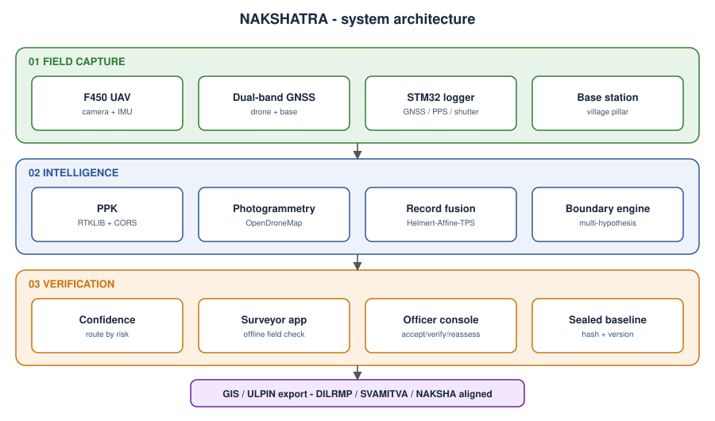

# Architecture

NAKSHATRA is split so that field work never depends on connectivity: everything the field layer needs is local, and
heavy processing happens later in an office with a normal machine.

## Layers

| Layer | Components | Code / docs |
|---|---|---|
| 01 Field capture | F450 UAV, mapping camera, dual-band GNSS, IMU, STM32 logger, village-pillar base station | `hardware/`, `firmware/` |
| 02 Intelligence | PPK (RTKLIB + CORS), photogrammetry (OpenDroneMap), historical record fusion, boundary hypothesis engine | `software/` |
| 03 Verification | confidence routing, surveyor app, officer console, sealed baseline, GIS/ULPIN export | `field-app/`, `web-console/`, `software/sealed-baseline`, `software/gis` |

## Data flow and file formats

| Stage | Input | Output |
|---|---|---|
| Capture | sky + ground | `gnssNNN.ubx`, `evtNNN.csv`, images, `baseNNN.ubx` |
| Event alignment | `evtNNN.csv`, `drone.pos` | `geo.txt` (EPSG:4326, `name lon lat h`) |
| PPK | RINEX drone / pillar / CORS / nav | `pillar.pos`, `drone.pos` (RTKLIB llh) |
| Photogrammetry | images + `geo.txt` | orthomosaic, `dsm.tif`, `dtm.tif` |
| Record fusion | control point pairs (historical, ground) | transform + LOOCV report |
| Boundary engine | DSM ridge map, fused lines, mapped features | ranked hypotheses with probabilities |
| Verification | low-confidence edges | field measurements (JSON), officer decisions (JSON) |
| Sealing | survey folder | `baseline.seal.json` (SHA-256 manifest, versioned, chained) |
| Export | final parcels | GeoJSON (ULPIN field left for the authority) |

## Design principles

1. **Decision support, not decision making.** Outputs are evidence and confidence for authorised officers.
2. **Keep every hypothesis.** Ambiguity is shown, not hidden; low confidence triggers field work.
3. **Report honest error.** Fusion residuals use leave-one-out validation; mismatching control points are flagged, not discarded.
4. **Offline-first.** Field capture and the surveyor app work without internet.
5. **Tamper-evident history.** Each sealed baseline hashes its files and links to the previous seal.

## What is implemented vs proposed

See the status table in the [README](../README.md#implementation-status).
