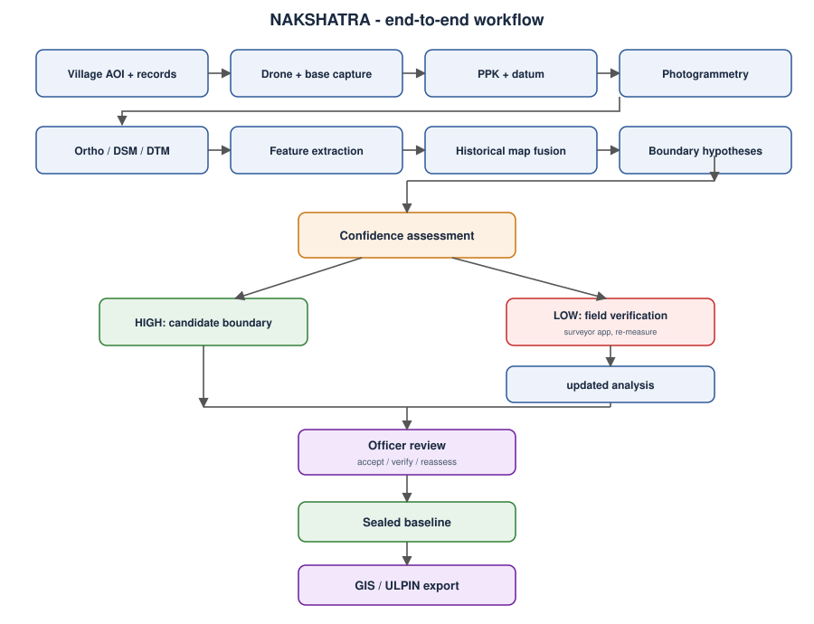

# Workflow

| # | Step | Inputs | Outputs | Tool |
|---|---|---|---|---|
| 1 | Define survey area | village boundary, historical map, 7/12 extracts | AOI, flight plan | QGIS |
| 2 | Establish base | pillar, antenna | `baseNNN.ubx` | `firmware/base-station` |
| 3 | Drone survey | flight plan | images, `gnssNNN.ubx`, `evtNNN.csv` | `firmware/drone-logger` |
| 4 | PPK | RINEX (drone, pillar, CORS) | `drone.pos` | `software/ppk-processing/run_ppk.py` |
| 5 | Geotag + photogrammetry | `drone.pos`, events, images | `geo.txt`, ortho / DSM / DTM | `align_events.py`, `run_odm.py` |
| 6 | Extract boundary evidence | DSM, ortho | ridge map, mapped features | `scoring.ridge_response` |
| 7 | Fuse historical records | historical map, control points | fused lines + LOOCV report | `fusion.fuse` |
| 8 | Boundary hypotheses | fused lines, ridge map | scored hypotheses | `scoring.score_edge` |
| 9 | Prioritise verification | confidence | field-check list | routing rule |
| 10 | Field verification | field-check list | re-measured points | `field-app/` |
| 11 | Officer review | evidence | accept / verify / reassess | `web-console/` |
| 12 | Seal | survey folder | `baseline.seal.json` | `software/sealed-baseline/seal.py` |
| 13 | Export | final parcels | GeoJSON | `software/gis/parcels.py` |

## Field day checklist

**Before flight:** base logging on a levelled antenna over the pillar; drone GNSS lock; logger shows PPS and a test camera event; camera settings locked.
**During flight:** note take-off/landing times; abort and re-fly any leg with missed triggers.
**After flight:** copy `baseNNN.ubx`, `gnssNNN.ubx`, `evtNNN.csv` and images to two places before formatting any card; record antenna heights and weather.

## Confidence routing (default thresholds, untuned)

- **HIGH**: top hypothesis probability >= 0.75 **and** top score >= 0.55. Goes to officer review as a candidate.
- **FIELD_CHECK**: anything else. Goes to the surveyor app, re-measured points feed back into the analysis.
