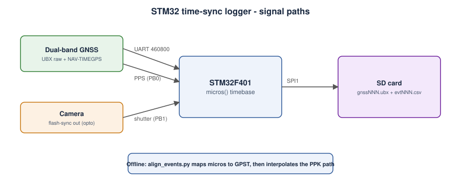

# STM32 time-sync logger

Records raw GNSS, PPS edges and camera-shutter events against one local microsecond clock so camera
positions can be recovered from the PPK trajectory. Firmware: [`firmware/drone-logger`](../../firmware/drone-logger).

## Board and pin map (STM32F401 "Blackpill")

| Signal | Pin | Notes |
|---|---|---|
| GNSS TX -> MCU RX | PA10 (USART1 RX) | 460800 baud, 3.3 V |
| MCU TX -> GNSS RX | PA9 (USART1 TX) | used for receiver configuration |
| GNSS PPS | PB0 (EXTI0) | rising edge |
| Camera flash-sync | PB1 (EXTI1) | through an optocoupler; falling edge = exposure |
| SD CS / SCK / MISO / MOSI | PA4 / PA5 / PA6 / PA7 | SPI1, FAT32 card |
| Status LED | PC13 | slow blink = logging, fast blink = SD failure |

Avoid PA0 (user key on most Blackpills) for the PPS line.

## Block diagram



## Log format (`evtNNN.csv`)

```
P,<pps_count>,<micros>
T,<micros>,<gps_week>,<tow_ms>
C,<cam_count>,<micros>
```

`micros` is the 32-bit STM32 counter and wraps every ~71.6 min; `align_events.py` unwraps it.

## Bring-up checklist

1. Configure the receiver: raw measurements (RXM-RAWX, SFRBX), NAV-TIMEGPS at 1 Hz, PPS on, 460800 baud.
2. Power up outdoors with sky view; confirm `P` rows arrive once per second in `evtNNN.csv`.
3. Trigger the camera by hand ten times; confirm ten `C` rows.
4. Check the `gnssNNN.ubx` file opens in u-center and shows RAWX messages.
5. Measure the camera's shutter delay (flash-sync vs actual exposure) and set it in `align_events.py --shutter-delay`.
6. Measure the antenna-to-camera lever arm and set `--lever-z`.

## Known limits

- Firmware has not been compiled or run on hardware in this repo; treat as a reference design.
- Camera-event time accuracy is bounded by the flash-sync signal's latency and jitter. Measure it, do not assume it.
